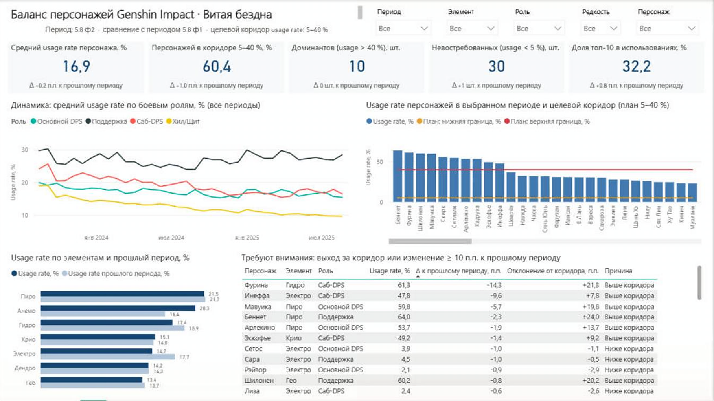

# Genshin Impact — дашборд баланса персонажей

Учебный проект: аналитический дашборд для руководителя отдела баланса боевой системы.
Тема 10 — «Анализ баланса игровых персонажей (классов) в N-игре».



## Состав работы

| № | Что требуется | Где лежит |
|---|---|---|
| 1 | Файл дашборда Power BI | `dashboard/Genshin_dashboard.pbix` и проект `dashboard/Genshin_dashboard.pbip` |
| 2 | Видео работы дашборда (≤ 2 мин) | `video/` — сценарий записи в `video/README.md` |
| 3 | Текстовое описание этапов | `report/Отчёт_Genshin_dashboard.docx`, подробно — `docs/` |
| 4 | Презентация выступления | `presentation/Презентация_Genshin_dashboard.pptx` и `.pdf` |
| 5 | Реализация ETL на Python | `etl/` |

## Структура

```
data/raw/          исходные данные до преобразований
data/processed/    подготовленные данные после ETL + журнал проверок dq_report.md
etl/               ETL-пайплайн (Python) и запросы Power Query
dashboard/         дашборд Power BI: .pbix и проект .pbip (модель TMDL + отчёт PBIR)
docs/              описание этапов, выводы, графики
report/            итоговый текстовый отчёт (.docx)
presentation/      презентация (.pptx, .pdf)
video/             видео работы дашборда
```

## Запуск

```
pip install -r requirements.txt
python etl/run_all.py
```

Затем открыть `dashboard/Genshin_dashboard.pbix` (или `.pbip`) в Power BI Desktop и нажать «Обновить».
Если папка проекта находится не в `C:\Users\Дарья\PycharmProjects\Genshin_dashboard`,
поменять параметр `DataFolder` (Преобразовать данные → Изменить параметры).
Подробнее — [docs/03_dashboard.md](docs/03_dashboard.md).

## Этапы

- [x] Этап 1. Предметная область, пользователь, управленческая задача — [docs/01_predmetnaya_oblast.md](docs/01_predmetnaya_oblast.md)
- [x] Этап 2. Сбор данных и ETL-пайплайн — [docs/02_etl.md](docs/02_etl.md)
- [x] Этап 3. Дашборд в Power BI — [docs/03_dashboard.md](docs/03_dashboard.md)
- [x] Этап 4. Выводы и рекомендации — [docs/04_vyvody.md](docs/04_vyvody.md)
