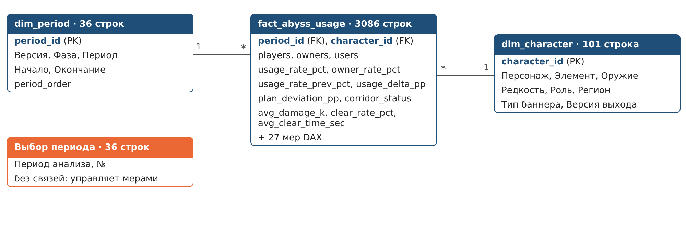

# Этап 2. Сбор, подготовка и загрузка данных (ETL)

## 2.1. Источники данных

Набор данных гибридный: реальный справочник персонажей + синтетическая статистика
эндгейм-контента. Открытой выгрузки с метриками использования по каждому персонажу
и периоду в нужном разрезе нет, поэтому статистика сгенерирована по сценарию.

| Файл (data/raw) | Тип | Источник | Содержимое |
|---|---|---|---|
| `genshin_db_characters.json` | открытый источник | [genshin-db](https://github.com/theBowja/genshin-db), коммит `8e5badd` от 04.11.2026 | 126 персонажей: id, имя (EN/RU), элемент, оружие, редкость, регион |
| `character_meta_manual.csv` | ручная разметка | составлено автором | версия выхода, боевая роль, тип баннера |
| `patch_calendar.csv` | ручная разметка | публичный календарь обновлений игры | версии 4.0–6.0 и даты выхода |
| `abyss_usage_raw.csv` | синтетика | `etl/01_generate_abyss_usage.py`, seed = 2026 | статистика «Витой бездны» по персонажам и периодам |

**Окно анализа:** патчи 4.0–5.8 (16.08.2023 – 09.09.2025), каждый патч разбит на две фазы
по ~3 недели → 36 периодов. Персонажи, вышедшие после 5.8, путешественники и манекены
в анализ не входят: итого **101 персонаж**.

## 2.2. Синтетические данные: сценарий генерации

Генерация — скрипт `etl/01_generate_abyss_usage.py` (он же служит «промптом» сценария;
полное описание правил — в его заголовке). Фиксированный seed даёт одинаковый результат.

**Заложенные закономерности**
1. Power creep — использование падает с каждым патчем после выхода персонажа.
2. Эффект релиза — всплеск использования в патч выхода.
3. Хилеры и щитовики постепенно теряют востребованность.
4. «Благословение бездны» — каждый период один элемент получает бонус.
5. Доля владельцев: высокая у 4★ и бесплатных, низкая у лимитированных 5★, растёт со временем.

**Заложенные отклонения**

| Код | Отклонение | Что должен увидеть руководитель |
|---|---|---|
| A | Беннет (51–68 %) и Фурина с 4.2 (61–82 %) | постоянные доминанты, выше плана |
| B | Шилонен (5.1), Ситлали и Мавуика (5.3) | новые доминанты; доля Пиро растёт |
| C | Нёвиллет: ~52 % → ~26 % в 5.0 | резкое падение к прошлому периоду |
| D | Син Цю: ~37 % (пик ~50 %) → ~5 % | ускоренное обесценивание |
| E | Качина, Фремине | новые персонажи, после патча выхода ниже 5 % |
| F | Ци Ци, Эмбер, Элой, Синь Янь, Саю | устойчиво невостребованы |
| G | Период 5.4 ф2: выборка 41,6 тыс. вместо ~74 тыс. | сбой сбора данных |

**Загрязнения сырого файла** (намеренно, чтобы Transform был содержательным):
смешанные форматы дат, версии вида `v4.0` и с пробелами, имена в разном регистре,
без пробелов и по-русски, дубликаты, пропуски и десятичная запятая в уроне,
ошибочное время прохождения (0, −1, 9999), `users > owners`, записи по персонажу
до его выхода, тестовый персонаж `Test_Dummy`.

### Сырые данные (до преобразований)

`abyss_usage_raw.csv` — 3 151 строка, 11 столбцов:

| Столбец | Пример | Проблема |
|---|---|---|
| record_id | 100004 | — |
| Cycle Date | 2024-02-21 / 21.02.2024 | два формата |
| Version | 4.4 / v4.4 / " 4.4 " | разное написание |
| Phase | 2 | — |
| Character | Jean / jean / Джинн / HuTao | 257 вариантов вместо 101 |
| Players Sampled | 64066 | — |
| Owners | 28899 | — |
| Users | 5656 | иногда больше Owners |
| Avg Damage (k) | 219.2 / 219,2 / пусто | запятая, пропуски |
| Clear Rate % | 79.9 | — |
| Avg Clear Time (s) | 116.4 / 9999 / -1 | ошибочные значения |

## 2.3. ETL-пайплайн

Запуск всего пайплайна: `python etl/run_all.py`
(или по шагам: `00_extract_characters.py` → `01_generate_abyss_usage.py` → `02_etl_pipeline.py`).

### Extract
- `00_extract_characters.py` — клонирует genshin-db на зафиксированном коммите,
  берёт JSON персонажей на английском и русском, сохраняет нужные поля.
- `02_etl_pipeline.py` читает все четыре сырых файла как текст (без автоприведения типов),
  чтобы ошибки формата обрабатывались явно.

### Transform

| Шаг | Что делается | Строк до → после | Результат |
|---|---|---|---|
| T1 | Имена столбцов → snake_case | 3151 → 3151 | |
| T2 | Удаление пробелов, версия `v4.0` → `4.0` | 3151 → 3151 | исправлено 309 |
| T3 | Даты двух форматов → единый тип date | 3151 → 3151 | 467 дат в ДД.ММ.ГГГГ |
| T4 | Имена персонажей → единый ключ (EN/RU, регистр, пробелы) | 3151 → 3145 | 348 переименований, удалён `Test_Dummy` |
| T5 | Удаление полных дубликатов и дублей по ключу | 3145 → 3098 | 47 дубликатов |
| T6 | Приведение типов, десятичная запятая | 3098 → 3098 | 30 запятых, 61 пропуск урона |
| T7 | Привязка к периоду по календарю, сверка дат | 3098 → 3098 | расхождений 0 |
| T8 | Удаление записей до даты выхода персонажа | 3098 → 3086 | 12 записей |
| T9 | Невозможные значения → пропуск | 3086 → 3086 | 9 × users>owners, 18 × время |
| T10 | Интерполяция пропусков внутри персонажа | 3086 → 3086 | 88 значений восстановлено |
| T11 | Расчёт метрик, Δ к прошлому периоду, статус коридора | 3086 → 3086 | |
| T12 | Итоговая таблица фактов | 3086 → 3086 | |

Подробный журнал прогона — `data/processed/dq_report.md`.

**Рассчитываемые показатели (T11)**

| Поле | Формула | Единица |
|---|---|---|
| owner_rate_pct | owners / players × 100 | % |
| usage_rate_pct | users / owners × 100 | % |
| presence_rate_pct | users / players × 100 | % |
| usage_rate_prev_pct | usage_rate в предыдущем периоде у того же персонажа | % |
| usage_delta_pp | usage_rate − usage_rate_prev | п.п. |
| plan_min_pct / plan_max_pct | целевой коридор 5 % / 40 % | % |
| plan_deviation_pp | выход за коридор (+ над верхней границей, − под нижней) | п.п. |
| corridor_status | Доминант (>40%) / В коридоре / Невостребован (<5%) | — |
| sharp_change_flag | 1, если \|Δ\| ≥ 10 п.п. | флаг |
| is_release_patch | 1, если период в патче выхода персонажа | флаг |

### Load
Python сохраняет звёздную схему в `data/processed/` (UTF-8, разделитель запятая,
десятичная точка) и проверяет целостность: все ключи факта есть в измерениях,
ключ (период, персонаж) уникален, users ≤ owners.

Загрузка в Power BI — скрипт Power Query `etl/powerbi_load.pq` с параметром
`DataFolder`; после повторного прогона ETL достаточно нажать «Обновить».

## 2.4. Подготовленные данные (после ETL)

## 2.5. Воспроизводимость

Повторный запуск `python etl/run_all.py` даёт побайтово идентичные файлы
(проверено сравнением SHA-256 всех файлов `data/raw` и `data/processed`):
источник зафиксирован коммитом, генератор — seed, шаги ETL выполняются
в фиксированном порядке.
