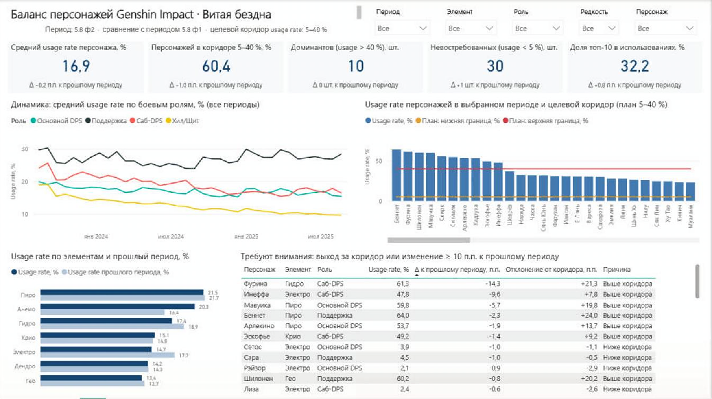

# Этап 3. Дашборд в Power BI

Файлы дашборда:
- `dashboard/Genshin_dashboard.pbix` — готовый отчёт с загруженными данными;
- `dashboard/Genshin_dashboard.pbip` — тот же отчёт в формате проекта Power BI:
  модель хранится в текстовом виде (TMDL), отчёт — в формате PBIR, поэтому
  изменения видны в истории git.



*Страница дашборда в Power BI Desktop, значения по умолчанию (период 5.8 ф2).*

## 3.1. Как открыть

**Быстрый просмотр:** открыть `dashboard/Genshin_dashboard.pbix` в Power BI Desktop —
данные уже загружены.

**Обновление данных после повторного ETL:**
1. Выполнить `python etl/run_all.py` — CSV в `data/processed/` будут пересозданы.
2. Открыть `.pbix` или `.pbip`.
3. Если проект лежит не в `C:\Users\Дарья\PycharmProjects\Genshin_dashboard`, изменить
   параметр: Главная → Преобразовать данные → Изменить параметры → `DataFolder`
   (путь к `data\processed\` с обратной косой чертой в конце).
4. Главная → Обновить.

## 3.2. Модель данных

Звёздная схема из этапа 2 и одна вспомогательная таблица:

| Таблица | Строк | Назначение |
|---|---|---|
| `fact_abyss_usage` | 3086 | факт: персонаж × период, все метрики и меры |
| `dim_character` | 101 | персонажи и их «классы»: элемент, оружие, роль, редкость, регион |
| `dim_period` | 36 | периоды (патч × фаза), даты начала и окончания |
| `Выбор периода` | 36 | несвязанная таблица для фильтра периода |

Связи: `dim_period[period_id] 1—* fact[period_id]`, `dim_character[character_id] 1—* fact[character_id]`,
фильтрация однонаправленная.

**Почему несвязанная таблица для периода.** Фильтр «Период» должен менять
карточки, рейтинг персонажей и таблицу внимания, но не обрезать график динамики,
который показывает все 36 периодов. Меры читают выбранный период через
`SELECTEDVALUE('Выбор периода'[№])`; если ничего не выбрано, берётся последний период.
Предыдущий период — это `№ − 1`, на нём построены все сравнения.

## 3.3. Меры (DAX)

| Мера | Единица | Смысл |
|---|---|---|
| Usage rate, % | % | средняя доля отрядов с персонажем среди его владельцев, выбранный период |
| Usage rate прошлого периода, % | % | то же за предыдущий период |
| Δ usage rate (пп) | п.п. | разница с прошлым периодом |
| В коридоре, % | % | доля персонажей с usage rate 5–40 % (план) |
| Доминантов (>40%) | шт. | персонажей выше верхней границы плана |
| Невостребованных (<5%) | шт. | персонажей ниже нижней границы плана |
| Доля топ-10 в использованиях, % | % | концентрация: доля 10 самых используемых персонажей в сумме использований |
| План: нижняя / верхняя граница, % | % | целевой коридор 5 и 40 % для графика |
| Требует внимания | флаг | 1, если персонаж вне коридора или \|Δ\| ≥ 10 п.п. |
| Δ текст: … | текст | подписи сравнения под карточками |

Ключевая мера:

```dax
Usage rate, % =
VAR p = [Выбранный период №]
RETURN
    CALCULATE(
        AVERAGE(fact_abyss_usage[usage_rate_pct]),
        REMOVEFILTERS(dim_period),
        dim_period[period_order] = p
    )
```

Концентрация использования:

```dax
Доля топ-10 в использованиях, % =
VAR p = [Выбранный период №]
VAR t =
    CALCULATETABLE(
        ADDCOLUMNS(VALUES(dim_character[character_id]), "@u", CALCULATE(SUM(fact_abyss_usage[users]))),
        REMOVEFILTERS(dim_period),
        dim_period[period_order] = p
    )
VAR topT = TOPN(10, t, [@u], DESC)
RETURN
    DIVIDE(SUMX(topT, [@u]), SUMX(t, [@u])) * 100
```

Полный список — `dashboard/Genshin_dashboard.SemanticModel/definition/tables/fact_abyss_usage.tmdl`.

## 3.4. Состав страницы (1280 × 720, без прокрутки)

| Элемент | Тип | Отвечает на вопрос |
|---|---|---|
| Фильтр «Период» | срез, выпадающий список, один период | временной фильтр |
| Фильтры «Элемент», «Роль», «Редкость», «Персонаж» | срезы | предметные фильтры по объекту и классам |
| 5 карточек KPI + строка «Δ к прошлому периоду» | карточки | сравнение с прошлым периодом и планом |
| Динамика usage rate по ролям | линейный график | вопрос 1: динамика |
| Usage rate персонажей + линии плана 5 % и 40 % | гистограмма с линиями | вопрос 2: лидеры и аутсайдеры, сравнение с планом |
| Usage rate по элементам и прошлый период | линейчатая диаграмма | вопросы 1–2: сравнение классов с прошлым периодом |
| Таблица «Требуют внимания» | таблица | вопрос 3: отклонения и объекты для решения |

**Обоснование выбора графиков**
- Динамика во времени — линейный график по датам начала периодов: все 36 периодов
  видны без прокрутки, 4 роли, видна тенденция.
- Ранжирование персонажей — столбцы по убыванию; линии плана сразу показывают,
  кто выше и ниже коридора.
- Сравнение двух периодов по 7 элементам — парные горизонтальные полосы:
  удобно сравнивать длины и читать подписи.
- Список объектов для решения — таблица: руководителю нужны имя, величина
  отклонения и причина, а не форма графика.

**Оформление:** один основной цвет (синий) для текущих значений, светло-синий для
прошлого периода; линии плана — оранжевая (5 %) и красная (40 %); разные цвета
только для ролей на графике динамики. Без 3D, декоративных диаграмм и фоновых
изображений. Рейтинг персонажей прокручивается внутри своего графика (101 персонаж),
сама страница помещается на один экран без прокрутки.

## 3.5. Сценарии работы с дашбордом

1. **Обзор текущего патча.** Без фильтров видно последний период: 10 доминантов,
   30 невостребованных, 60,4 % персонажей в коридоре.
2. **Поиск отклонения.** Период «5.0 ф1» → в таблице внимания Нёвиллет с Δ −23,3 п.п.
3. **Анализ класса.** Роль «Хил/Щит» → график динамики показывает падение
   usage rate с 19 % до 9,6 %, рейтинг — что 6 из 20 хилеров ниже коридора,
   а ещё 6 находятся у его нижней границы (5–10 %).
4. **Карточка персонажа.** Фильтр «Персонаж» → карточки, график динамики и рейтинг
   для одного персонажа.
5. **Перекрёстная фильтрация.** Щелчок по столбцу персонажа в рейтинге фильтрует
   остальные визуалы.

## 3.6. Проверка в Power BI Desktop

Проект открыт и обновлён в Power BI Desktop, ошибок загрузки нет. Значения карточек
по умолчанию совпадают с независимым расчётом в Python по `data/processed`:
16,9 % · 60,4 % · 10 шт. · 30 шт. · 32,2 %; Δ к 5.8 ф1: −0,2 п.п. · −1,0 п.п. · 0 · +1 · +0,8 п.п.
Проверены фильтры «Период» (5.0 ф1 → Нёвиллет −23,3 п.п. первым в таблице),
«Роль», «Элемент», «Персонаж» и перекрёстная фильтрация из рейтинга.
