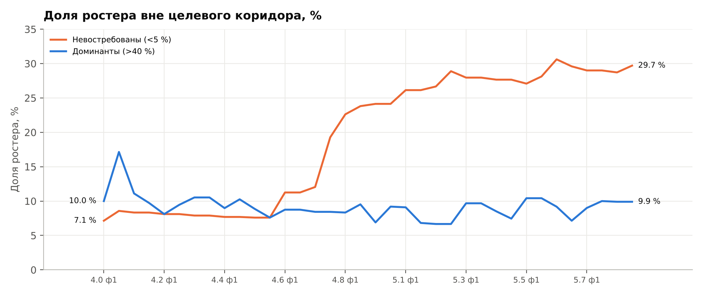
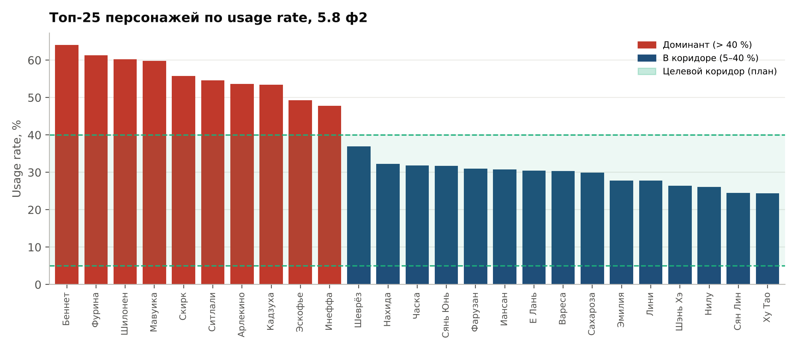
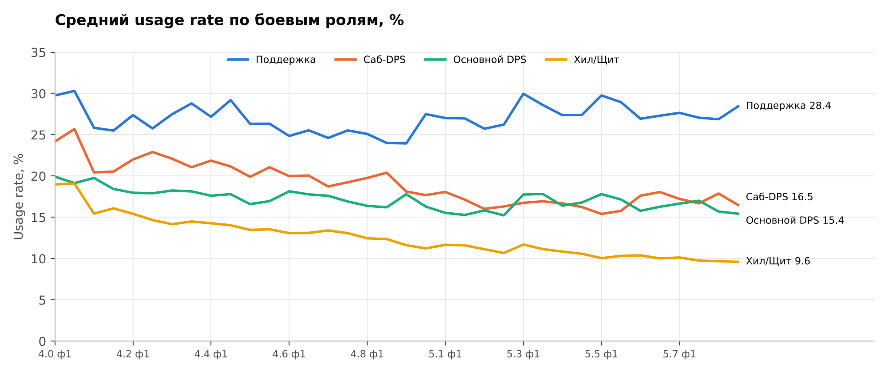
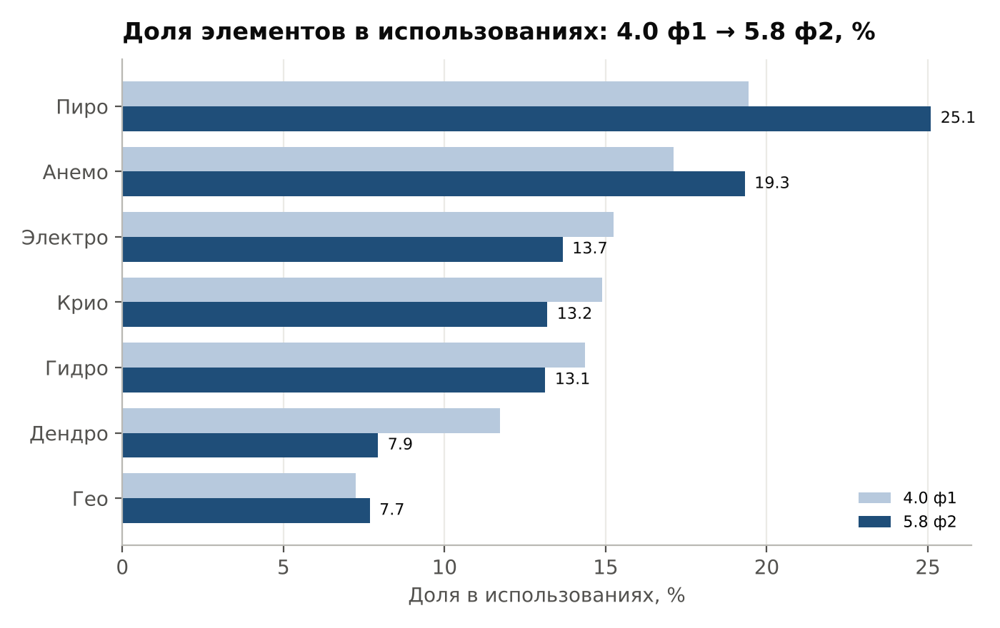
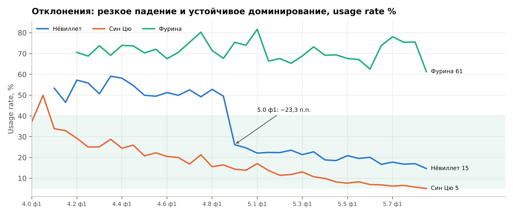

# Этап 4. Выводы и управленческие рекомендации

Период по умолчанию — 5.8 ф2 (последний в окне анализа), сравнение — с 5.8 ф1
и с началом окна (4.0 ф1). Целевой коридор usage rate (план): 5–40 %.

## 4.1. Что показывает дашборд прямо сейчас (5.8 ф2)

| Показатель | Значение | Δ к 5.8 ф1 | Для сравнения: 4.0 ф1 |
|---|---|---|---|
| Средний usage rate персонажа | 16,9 % | −0,2 п.п. | 22,5 % |
| Персонажей в коридоре 5–40 % | 60,4 % | −1,0 п.п. | 82,9 % |
| Доминантов (> 40 %) | 10 шт. | 0 | 7 шт. |
| Невостребованных (< 5 %) | 30 шт. | +1 | 5 шт. |
| Доля топ-10 в использованиях | 32,2 % | +0,8 п.п. | 35,7 % |

## 4.2. Выводы

**Вывод 1. Ростер расслаивается: почти треть персонажей не используется.**
Доля персонажей ниже коридора выросла с 7,1 % (5 из 70) в 4.0 ф1 до 29,7 %
(30 из 101) в 5.8 ф2, доля персонажей в коридоре упала с 82,9 % до 60,4 %.
Из 30 невостребованных 24 — персонажи 4★ и 26 вышли до версии 4.0.
Это классический power creep: новые персонажи вытесняют старых, и старые
не получают поддержки.
*Подтверждение:* карточки «В коридоре» и «Невостребованных», рейтинг персонажей
с линией плана 5 %.

**Вывод 2. Ядро из нескольких персонажей обязательно для отрядов.**
Беннет выше 40 % во всех 36 периодах, Кадзуха — в 34, Фурина — во всех 32 периодах
после выхода (минимум 61 %). В 5.8 ф2 доминантов 10, трое из них выше 60 %:
Беннет 64,0 %, Фурина 61,3 %, Шилонен 60,2 %. Доля топ-10 в использованиях
все 36 периодов держится в диапазоне 31–38 %: примерно каждое третье место
в отрядах занимают 10 персонажей из 101.
*Подтверждение:* рейтинг персонажей (столбцы выше линии 40 %), таблица «Требуют
внимания», карточка «Доля топ-10».

**Вывод 3. Роль хилеров и щитовиков обесценивается.**
Средний usage rate роли «Хил/Щит» упал вдвое: с 19,0 % до 9,6 %. У роли «Поддержка»
он почти не изменился (30,0 → 27,7 % в среднем за две фазы). 6 из 20 хилеров
ниже коридора, ещё 6 — в зоне риска (5–10 %). Контент поощряет урон и баффы,
а не выживание.
*Подтверждение:* график динамики по ролям, фильтр «Роль = Хил/Щит».

**Вывод 4. Мета смещается в сторону Пиро.**
Доля Пиро в использованиях выросла с 19,4 до 25,1 %, а после выхода Мавуики (5.3)
трое из семи самых используемых персонажей — Пиро (Беннет, Мавуика, Арлекино).
Дендро потеряло больше всех: 11,7 → 7,9 %.
*Подтверждение:* линейчатая диаграмма по элементам.

**Вывод 5. Резкие сдвиги видны только при сравнении с прошлым периодом.**
Нёвиллет был доминантом в 4.1–4.8 (в среднем 52,5 %) и в 5.0 ф1 потерял 23,3 п.п. за один период.
Отдельно видна аномалия данных: в 5.4 ф2 выборка — 41,6 тыс. игроков вместо
~74 тыс. в соседних периодах (−44 %), и выводы по этому периоду надёжны меньше.
*Подтверждение:* таблица «Требуют внимания» при выборе 5.0 ф1.

## 4.3. Управленческие рекомендации

1. **Вернуть в игру невостребованных 4★ через контент, а не через прямые баффы.**
   В план балансировки следующего патча включить 5–7 персонажей из таблицы
   «Невостребован» (Качина, Фремине, Синь Янь, Ноэлль, Рэйзор, Коллеи, Кавех).
   Инструменты: «благословение бездны» и составы врагов под их механики,
   бесплатное оружие из события, усиливающее их класс. Цель — снизить число
   невостребованных с 30 до 20 за два патча.
2. **Ослабить зависимость от ядра доминантов.**
   Не усиливать в контенте Пиро и механики, на которых построены Беннет, Фурина
   и Шилонен; следующие два «благословения бездны» отдать Дендро и Гео
   (самые низкие доли — 7,9 и 7,7 %). Целевой показатель — доля топ-10
   в использованиях ниже 30 %.
3. **Дать работу хилерам.** Добавить в эндгейм-циклы условия, где лечение и щиты
   дают преимущество (урон по отряду со временем, бонусы за полное HP), и проверить
   результат по графику ролей: цель — вернуть средний usage rate роли к 13–15 %.
4. **Встроить дашборд в цикл патча.** Смотреть его после каждой фазы бездны:
   таблица «Требуют внимания» — входной список для планёрки по балансу;
   любой персонаж с Δ ≥ 10 п.п. разбирается отдельно. Отдельно контролировать
   объём выборки: при падении больше чем на 20 % период помечается как ненадёжный.
